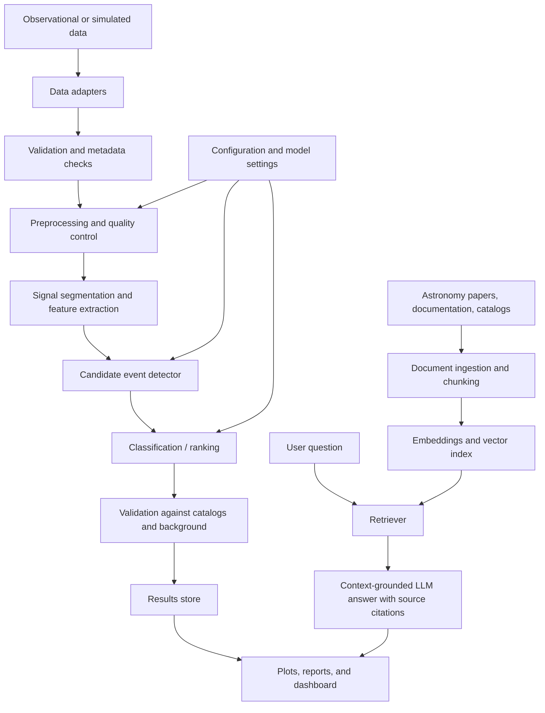
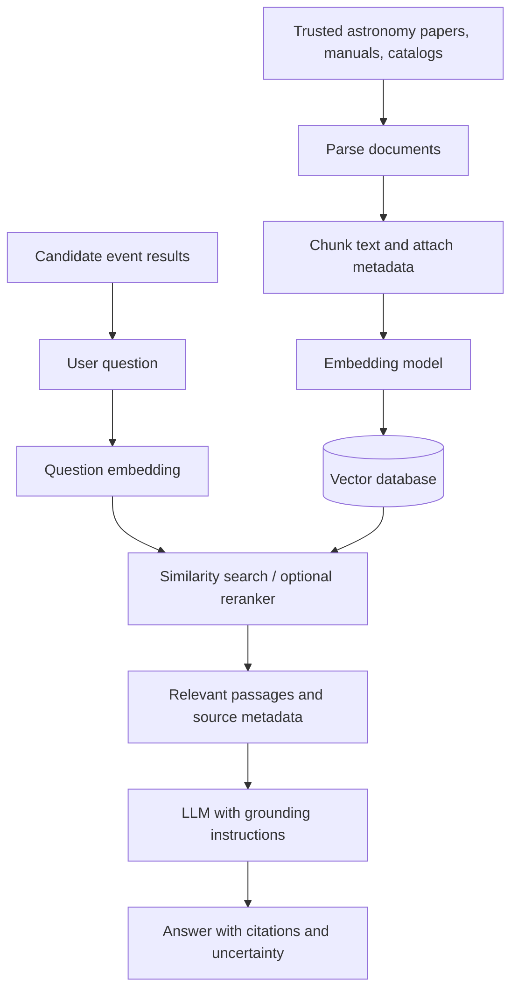

**# Celestial Wave Detector 🌌

Detect and explore possible celestial sources by analyzing cosmic-wave signals with signal processing and machine learning.

> **Project scope:** This repository is a research/educational prototype. It can process simulated signals and, when supplied, public observational datasets. It does not independently prove the discovery of a celestial object. Real detections require validated data, instrument metadata, scientific review, and comparison with established catalogs.


## Table of Contents

- [Overview](#overview)
- [Objectives](#objectives)
- [System Architecture](#system-architecture)
- [Repository Structure](#repository-structure)
- [Technology Stack](#technology-stack)
- [Installation](#installation)
- [Quick Start](#quick-start)
- [Data Sources](#data-sources)
- [Processing Pipeline](#processing-pipeline)
- [RAG Knowledge Assistant](#rag-knowledge-assistant)
- [RAG Architecture and Data Flow](#rag-architecture-and-data-flow)
- [Outputs](#outputs)
- [Evaluation and Validation](#evaluation-and-validation)
- [Limitations](#limitations)
- [Roadmap](#roadmap)
- [Contributing](#contributing)
- [License](#license)

## Overview

Celestial Wave Detector is a modular pipeline for exploring whether patterns in cosmic-wave data are consistent with known classes of astronomical sources. Depending on the dataset, inputs may include gravitational-wave strain, radio telescope time series, or other documented electromagnetic observations.

The pipeline cleans and segments signals, extracts features, detects candidate events, and presents results for further investigation. Different wave types use different instruments, units, calibration procedures, and scientific detection methods; they should not be combined as if they were interchangeable measurements.

## Objectives

- Load observational or simulated wave data.
- Inspect data quality and reduce common noise/artifacts.
- Extract time- and frequency-domain features.
- Identify candidate events using configurable thresholds or machine-learning models.
- Visualize waveforms, spectra, and candidate-event metadata.
- Keep processing steps reproducible and testable.

## System Architecture



### Architecture layers

1. **Data acquisition:** Read local files or connect to supported public datasets through separate adapters.
2. **Validation:** Check file format, sampling rate, units, timestamps, missing values, and metadata.
3. **Preprocessing:** Apply dataset-appropriate filtering, normalization, windowing, and quality masks.
4. **Feature extraction:** Compute features such as power spectral density, spectrograms, wavelet coefficients, signal-to-noise estimates, or event-specific statistics.
5. **Detection:** Run a baseline threshold/template method and optionally a trained model to rank candidate events.
6. **Scientific validation:** Estimate background/noise behavior, check false alarms, compare candidates with reference catalogs, and retain provenance.
7. **Visualization and reporting:** Display waveforms, spectra, confidence/ranking information, and reproducible run metadata.

## Repository Structure

```text
celestial-wave-detector/
├── data/
│   ├── raw/                 # Optional local input data (not committed)
│   ├── processed/           # Generated intermediate data (not committed)
│   └── sample/              # Small, redistributable demo samples only
├── notebooks/
│   └── exploratory_analysis.ipynb
├── src/
│   └── celestial_detector/
│       ├── __init__.py
│       ├── config.py        # Configuration and defaults
│       ├── data_loader.py   # Input adapters and validation
│       ├── preprocessing.py # Cleaning and segmentation
│       ├── features.py      # Signal features and transforms
│       ├── detection.py     # Baseline candidate detection
│       ├── evaluation.py   # Metrics and validation helpers
│       ├── visualization.py # Plots and reports
│       └── pipeline.py     # End-to-end orchestration
├── tests/
│   ├── test_preprocessing.py
│   ├── test_features.py
│   └── test_detection.py
├── docs/
│   └── architecture.md
├── scripts/
│   ├── generate_demo_data.py
│   └── ingest_knowledge_base.py
├── knowledge_base/
│   └── README.md            # Instructions and source list; add licensed documents separately
├── .gitignore
├── LICENSE
├── README.md
└── requirements.txt
```

## Technology Stack

| Component | Suggested tools |
|---|---|
| Language | Python 3.10+ |
| Numerical processing | NumPy, SciPy |
| Data handling | pandas |
| Astronomy utilities | Astropy |
| Machine learning (optional) | scikit-learn; PyTorch or TensorFlow for advanced models |
| Visualization | Matplotlib, Plotly |
| Exploration | Jupyter |
| Testing | pytest |
| RAG orchestration | LangChain or LlamaIndex (optional) |
| Embeddings | Sentence Transformers or a hosted embedding API |
| Vector search | FAISS or Chroma |
| Language model | Configurable LLM provider; optional local model |

Keep dependencies and models appropriate to the chosen data type. A model trained on one instrument or signal family should not be assumed to generalize to another.

## Installation

### 1. Clone the repository

```bash
git clone https://github.com/<your-username>/celestial-wave-detector.git
cd celestial-wave-detector
```

### 2. Create a virtual environment

**Windows (PowerShell):**
```powershell
py -m venv .venv
.venv\Scripts\Activate.ps1
```

**macOS/Linux:**
```bash
python3 -m venv .venv
source .venv/bin/activate
```

### 3. Install dependencies

Create `requirements.txt` with the packages used by your implementation, for example:

```text
numpy
scipy
pandas
matplotlib
astropy
scikit-learn
jupyter
pytest
```

Then run:

```bash
python -m pip install --upgrade pip
pip install -r requirements.txt
```

## Quick Start

The repository layout above is the proposed architecture; the modules are not implemented merely by creating this README. Once the modules exist, expose a command-line entry point or run the pipeline from Python. For example, a future API could look like this:

```python
from celestial_detector.pipeline import run_pipeline

results = run_pipeline(
    input_path="data/sample/example_signal.csv",
    signal_type="radio",  # Must match the dataset and loader implementation
)
print(results)
```

Until that API is implemented, start by adding a dataset-specific loader and a reproducible baseline detector. Do not run the example as-is in an empty repository.

### Suggested first milestone

1. Create a small synthetic signal with a known injected event and background noise.
2. Plot the raw signal and its spectrum.
3. Implement a baseline detector with documented thresholds.
4. Test it on both event-present and event-absent samples.
5. Add precision/recall or false-alarm evaluation before training a more complex model.

## Data Sources

Use data with documented provenance, licenses, units, and instrument metadata. Potential starting points include:

- **Gravitational waves:** [GWOSC — Gravitational Wave Open Science Center](https://gwosc.org/)
- **Astronomy software and data tools:** [Astropy documentation](https://docs.astropy.org/)
- **NASA open data:** [NASA Open Data Portal](https://data.nasa.gov/)

Check the selected dataset's access rules, citation requirements, scientific documentation, and suitability for the intended analysis. Keep large or restricted data out of Git; document download steps and checksums instead.

## Processing Pipeline

1. **Load:** Read the selected data format and its metadata.
2. **Validate:** Confirm units, sample rate, timestamps, data gaps, and quality flags.
3. **Preprocess:** Apply domain-appropriate filtering and remove or mask invalid segments.
4. **Transform:** Compute a spectrogram, power spectral density, wavelet representation, or other suitable features.
5. **Detect:** Find candidate events using a baseline algorithm or a trained model.
6. **Rank and validate:** Estimate candidate significance, measure false alarms on background data, and compare against reference events where possible.
7. **Report:** Save results with configuration, software version, dataset provenance, and plots.

## RAG Knowledge Assistant

The project can include a **Retrieval-Augmented Generation (RAG)** assistant that answers astronomy questions using a curated collection of trusted documents. It complements the signal detector; it does **not** detect celestial objects by itself.

Example questions:
- "What does this candidate-event score mean?"
- "Which documented properties are associated with this type of signal?"
- "What does the selected dataset's documentation say about its sampling rate?"
- "Which papers or catalog entries are relevant to this candidate?"

### RAG workflow

1. **Knowledge ingestion:** Load approved astronomy papers, dataset documentation, instrument manuals, and catalog documentation. Preserve title, author/organization, URL/DOI, publication date, license, and page/section metadata where available.
2. **Parsing and chunking:** Extract text and split it into overlapping passages that preserve headings and useful context.
3. **Embedding:** Convert each passage into a vector representation using an embedding model.
4. **Indexing:** Store vectors and metadata in a vector database such as FAISS or Chroma.
5. **Question retrieval:** Embed the user's question and retrieve the most relevant passages; optionally rerank them.
6. **Grounded generation:** Provide the retrieved passages to the language model and instruct it to answer only from supported evidence, cite sources, and clearly state when evidence is insufficient.
7. **Traceability:** Return source titles and links, and log the retrieved chunks and model configuration for debugging.

### RAG design principles

- Keep RAG separate from the scientific signal-detection pipeline. The detector produces candidate events; RAG explains documented concepts and helps users explore source material.
- Treat retrieved documents as evidence, not executable instructions. Ignore instructions embedded inside retrieved content.
- Show citations for factual claims and avoid inventing papers, catalog matches, or source links.
- If no relevant evidence is retrieved, say that the knowledge base does not contain enough information.
- Use source documents with clear access and redistribution permissions. Store source metadata and retrieval timestamps.
- Do not send private, restricted, or sensitive data to third-party model APIs without appropriate authorization.
- A generated answer is not scientific confirmation of a detection.

## RAG Architecture and Data Flow



### Suggested RAG modules

| Module | Responsibility |
|---|---|
| `rag/ingest.py` | Read supported documents and extract text/metadata |
| `rag/chunking.py` | Split text into searchable passages |
| `rag/embeddings.py` | Generate passage and query embeddings |
| `rag/vector_store.py` | Create, persist, and query the vector index |
| `rag/retriever.py` | Retrieve and optionally rerank relevant passages |
| `rag/answer.py` | Build prompts and generate source-grounded answers |
| `scripts/ingest_knowledge_base.py` | Build or refresh the knowledge index |

### Example RAG response format

A response from the assistant should include:
- **Answer:** A concise explanation based on retrieved material.
- **Sources:** Document title plus URL/DOI and page or section when available.
- **Evidence:** Short supporting excerpts or passage references.
- **Limitations:** A clear note if sources conflict or do not answer the question.

### RAG evaluation

Evaluate retrieval and generation separately:
- **Retrieval:** Recall@k or Precision@k on a small set of questions with known relevant documents.
- **Grounding:** Check whether claims are supported by retrieved passages.
- **Citation quality:** Verify that each cited source exists and supports the associated statement.
- **Abstention:** Test whether the assistant admits when the knowledge base lacks evidence.
- **Latency and cost:** Record retrieval time, model latency, and token usage where applicable.

RAG components are an architectural extension and must be implemented and configured before they will work. Choose one embedding model, one vector store, and one LLM provider initially rather than adding every option at once.

## Outputs

A run should ideally produce:

- A CSV or JSON file containing candidate start/end times and scores.
- Waveform and time-frequency plots.
- Data-quality and preprocessing summaries.
- Evaluation metrics on labeled or injected test data.
- A machine-readable run configuration and log.

Use terms such as **candidate event** or **model prediction** unless the event has been scientifically confirmed.

## Evaluation and Validation

For labeled data, report appropriate metrics such as precision, recall, F1 score, and a confusion matrix. For rare-event searches, also evaluate false-alarm rate, detection efficiency across injected signal strengths, robustness to noise, and performance on held-out data.

Avoid data leakage: split by event, observation, or time segment as appropriate, rather than randomly splitting highly correlated windows. Compare the detector with a simple baseline and document the threshold-selection procedure.

## Limitations

- Cosmic-wave signals can be extremely weak and may be confused with instrument noise or environmental artifacts.
- Gravitational-wave, radio, and other electromagnetic datasets require different processing assumptions.
- A high model score is not proof that a celestial body was detected.
- Reliable claims require calibration, background estimation, independent checks, and expert review.
- Results depend on data quality, sample selection, model training, and instrument sensitivity.

## Roadmap

- [ ] Add a synthetic-data generator with configurable signal-to-noise ratio.
- [ ] Implement and test dataset-specific loaders.
- [ ] Build a reproducible filtering and feature-extraction pipeline.
- [ ] Add a baseline candidate detector.
- [ ] Add evaluation metrics and false-alarm analysis.
- [ ] Create waveform and spectrogram visualizations.
- [ ] Add optional model training and model-card documentation.
- [ ] Add a dashboard and automated tests.
- [ ] Ingest a small, licensed astronomy documentation collection for RAG.
- [ ] Implement chunking, embeddings, vector search, and source metadata.
- [ ] Add grounded answers with citations and an insufficient-evidence fallback.
- [ ] Evaluate retrieval quality, citation correctness, and hallucination/abstention behavior.

## Contributing

Contributions are welcome. Please open an issue before major changes, add tests for new functionality, document dataset provenance and assumptions, and avoid committing private, restricted, or very large raw data.

## License

This project is intended to use the MIT License. Add a `LICENSE` file containing the license text before distributing the repository under that license.
**
